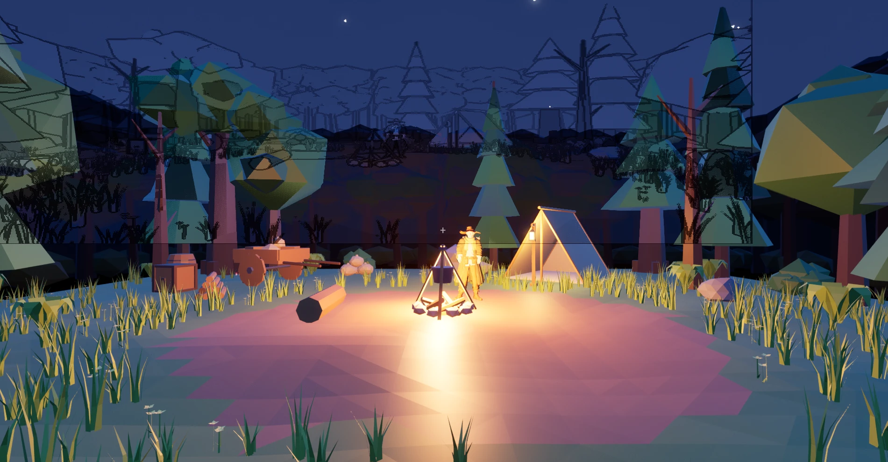

지난번 느낀 점에 적은 **재질 문제**를 손보는 것. 결론부터 말하면 무광 처리랑 주변광은 남기고, 셀 셰이딩은 해 보고 뺐음. 이번에도 내가 프롬프트로 시키고 → AI가 만들고 → 내가 한 것만 적음.

## 1. 재질이 왜 어색한지 진단

### 내가 쓴 프롬프트

> 자 다음 작업 하자

### AI가 알려 준 것

AI가 상인 머티리얼, 텍스처, 맵 조명을 조회해서 원인을 3개로 정리해 줌

- **머티리얼이 실사용 기본값 그대로**: 텍스처가 BaseColor에만 꽂혀 있고 거칠기·반사는 기본값이라, 애니 그림 위에 반질거리는 하이라이트랑 실사식 명암이 한 번 더 얹힘. 그래서 고무나 플라스틱처럼 보임
- **조명이 주황색 점광원뿐**: 모닥불이랑 랜턴 말고는 주변광(SkyLight)이 없어서, 빛 안 받는 쪽은 새까맣고 받는 쪽은 전부 주황색
- **톤매퍼가 Filmic 기본값**: 채도·대비가 실사 쪽으로 눌림

그리고 고치는 순서를 제안함: ① 무광 처리 → ② 푸른 주변광 → ③ 셀 셰이딩 + 외곽선

## 2. 무광 처리 + 주변광

### 내가 쓴 프롬프트

> 1번부터 순서대로

### AI가 만들어 준 것

- 상인이랑 배낭 머티리얼에 **Roughness 1, Specular 0** 을 연결해서 반질거림을 없앰
- 맵에 아주 약한 **푸른 SkyLight** 를 추가함. 0.3은 너무 약하고 1.0은 밤 느낌이 사라져서 **0.6**으로 정함. 그림자 쪽 코트 색이 보이고 나무·바위에 푸른 밤빛이 돌게 됨

## 3. 셀 셰이딩 시도

### AI가 만들어 준 것

- 화면 전체에 거는 **포스트 프로세스 머티리얼**을 HLSL로 짬. 빛 밝기를 3단계로 끊고, 깊이·노멀이 끊기는 곳에 검은 외곽선을 그리는 것
- 값은 머티리얼 인스턴스로 빼서 슬라이더로 조절할 수 있게 함

### 중간에 생긴 일

> 아니 이상하게 레이어가 나뉘어졌는데

- 플레이하니까 하늘 쪽에 **축소된 장면 윤곽선이 유령처럼** 겹쳐 보였음
- AI가 찾은 원인은 플레이 화면이 내부 렌더 버퍼보다 작은데, 깊이·노멀을 화면 색이랑 같은 좌표로 읽고 있었던 것. 에디터 뷰포트는 크기가 같아서 AI가 찍은 스크린샷에선 안 보였음
- 각 버퍼를 자기 좌표로 읽게 고쳐서 유령은 사라짐

> 겹치긴했는데 너무 짜글짜글해진다.

- AI가 외곽선을 안티에일리어싱(TSR) 앞으로 옮기고, 안쪽 선 기준을 올리고 선 굵기를 줄임

### 내가 한 것

> 음 이 셰이더는 아닌거 같아 좀 더 사실적이게 가는게 맞는거 같아 그리고 자글거리는것도 똑같고 약간 모델이 겹쳐 있는것처럼 보여

- 셀 셰이딩은 빼기로 함. AI가 맵에서 효과를 지우고 셰이더 에셋도 삭제함
- 무광 처리랑 주변광은 남김

> 이제 괜찮다 일단 이대로 가고 맵부터 트리포로 뽑아내자

## 완성

셀 셰이딩은 안 맞아서 빼고, 방향을 **좀 더 사실적인 쪽**으로 잡음. 다음은 맵을 트리포로 다시 만드는 것.
